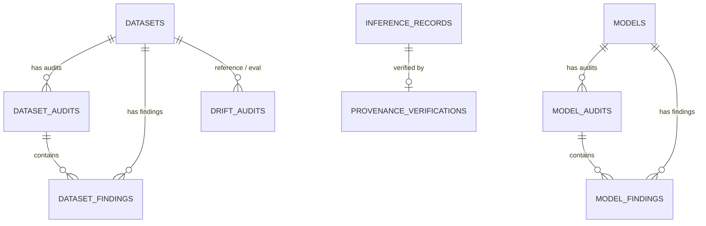

# SentinelCV: Database Schema Documentation

## 1. Overview
SentinelCV utilizes a local, embedded SQLite 3 relational database located at `data/sentinelcv.db`.
- **Journal Mode**: Write-Ahead Logging (`WAL`) for concurrent read performance.
- **Integrity**: Foreign key constraints enabled (`PRAGMA foreign_keys = ON;`).
- **Initialization**: Automatically applied on startup via `ResourceDatabasePopulator` using `db/schema.sql`.

---

## 2. Entity Relationship Diagram (ERD)

---

## 3. Table Definitions

### 3.1 `datasets`
Stores registered computer vision datasets.
- `id` (INTEGER, PRIMARY KEY AUTOINCREMENT)
- `name` (TEXT, NOT NULL)
- `format` (TEXT, NOT NULL, CHECK in ('COCO', 'YOLO'))
- `path` (TEXT, NOT NULL)
- `total_images` (INTEGER, DEFAULT 0)
- `total_annotations` (INTEGER, DEFAULT 0)
- `total_classes` (INTEGER, DEFAULT 0)
- `file_size_bytes` (INTEGER, DEFAULT 0)
- `sha256_hash` (TEXT)
- `created_at` (TEXT, DEFAULT current timestamp)
- `updated_at` (TEXT, DEFAULT current timestamp)

### 3.2 `dataset_audits`
Tracks audit executions and integrity scores.
- `id` (INTEGER, PRIMARY KEY AUTOINCREMENT)
- `dataset_id` (INTEGER, FOREIGN KEY -> datasets.id)
- `status` (TEXT, CHECK in ('PENDING','RUNNING','COMPLETED','FAILED','CANCELLED'))
- `started_at` (TEXT), `completed_at` (TEXT)
- `total_findings` (INTEGER), `critical_findings` (INTEGER), `high_findings` (INTEGER), `medium_findings` (INTEGER), `low_findings` (INTEGER), `info_findings` (INTEGER)
- `integrity_score` (REAL, 0.0 - 100.0)
- `assessment_decision` (TEXT, CHECK in ('ACCEPT','REVIEW','QUARANTINE'))
- `summary` (TEXT), `error_message` (TEXT)

### 3.3 `dataset_findings`
Specific integrity and duplicate findings detected during dataset audits.
- `id` (INTEGER, PRIMARY KEY AUTOINCREMENT)
- `audit_id` (INTEGER, FOREIGN KEY -> dataset_audits.id)
- `dataset_id` (INTEGER, FOREIGN KEY -> datasets.id)
- `finding_id` (TEXT, NOT NULL)
- `category` (TEXT, NOT NULL)
- `description` (TEXT, NOT NULL)
- `severity` (TEXT, CHECK in ('CRITICAL','HIGH','MEDIUM','LOW','INFO'))
- `confidence` (REAL, 0.0 - 1.0)
- `evidence` (TEXT), `affected_asset` (TEXT), `recommended_action` (TEXT)

### 3.4 `models`
Stores registered ML model artifacts.
- `id` (INTEGER, PRIMARY KEY AUTOINCREMENT)
- `name` (TEXT, NOT NULL)
- `format` (TEXT, CHECK in ('ONNX', 'TORCHSCRIPT', 'UNKNOWN'))
- `path` (TEXT, NOT NULL)
- `file_size_bytes` (INTEGER)
- `sha256_hash` (TEXT)
- `metadata_json` (TEXT)
- `input_info` (TEXT), `output_info` (TEXT)

### 3.5 `model_audits`
Tracks model audits, structural fingerprints, and decisions.
- `id` (INTEGER, PRIMARY KEY AUTOINCREMENT)
- `model_id` (INTEGER, FOREIGN KEY -> models.id)
- `status` (TEXT)
- `behavioral_fingerprint` (TEXT)
- `assessment_decision` (TEXT)
- Finding counters (`critical_findings`, `high_findings`, etc.)

### 3.6 `inference_records`
Stores inference events for provenance and tamper detection.
- `id` (INTEGER, PRIMARY KEY AUTOINCREMENT)
- `record_id` (TEXT, UNIQUE, NOT NULL)
- `timestamp` (TEXT, NOT NULL)
- `model_identifier` (TEXT), `model_hash` (TEXT)
- `input_image_hash` (TEXT), `config_hash` (TEXT), `output_hash` (TEXT)
- `nonce` (TEXT), `sequence_number` (INTEGER)
- `previous_record_hash` (TEXT), `current_record_hash` (TEXT)
- `signature` (TEXT), `hmac_value` (TEXT)
- `raw_output` (TEXT)

### 3.7 `provenance_verifications`
Detailed verification check outcomes per record.
- `id` (INTEGER, PRIMARY KEY AUTOINCREMENT)
- `record_id` (TEXT, FOREIGN KEY -> inference_records.record_id)
- `input_hash_status`, `model_hash_status`, `output_hash_status` (TEXT)
- `chain_link_status`, `nonce_status`, `sequence_status`, `signature_status` (TEXT)
- `overall_status` (TEXT, 'VERIFIED' or 'FAILED')
- `details` (TEXT)

### 3.8 `drift_audits`
Stores distribution shift comparisons between datasets.
- `id` (INTEGER, PRIMARY KEY AUTOINCREMENT)
- `reference_dataset_id` (INTEGER, FOREIGN KEY -> datasets.id)
- `evaluation_dataset_id` (INTEGER, FOREIGN KEY -> datasets.id)
- `drift_detected` (INTEGER, 0 or 1)
- `overall_drift_score` (REAL)
- `severity` (TEXT)
- `metrics_json` (TEXT)

### 3.9 `security_findings`
System-wide aggregated findings table.

### 3.10 `audit_reports` & `audit_history`
Maintains permanent audit reports metadata and compliance history records.
