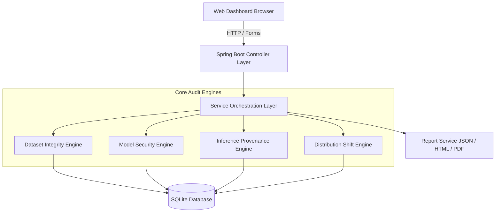
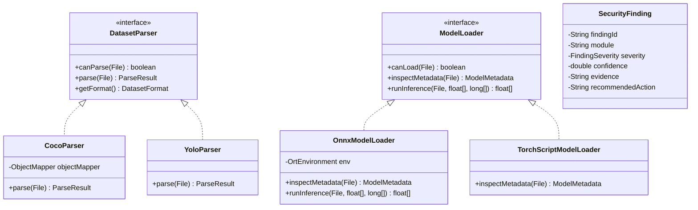
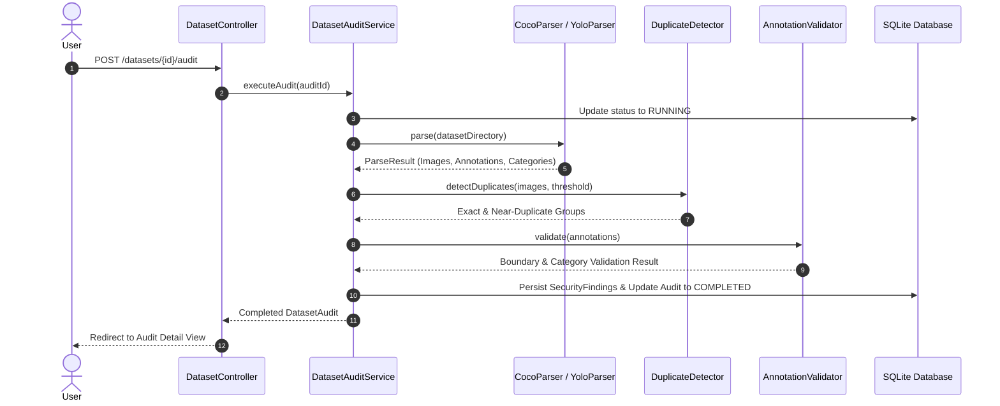
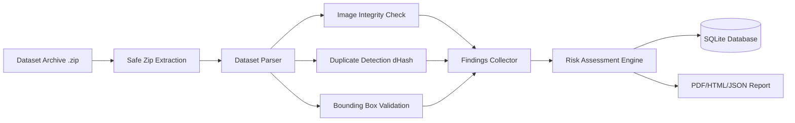

# SentinelCV: Academic Project Report
## Offline Computer Vision Security and Integrity Assessment System

**Academic Year**: 2026  
**Degree**: End-Semester Capstone Project  
**Platform**: Java 21 LTS / Spring Boot / SQLite / ONNX Runtime / OpenPDF  

---

## 1. Title Page
- **Project Title**: SentinelCV: Offline Computer Vision Security and Integrity Assessment System
- **Authors**: Autonomous Senior Engineering Team
- **Environment**: Standalone Offline Workstation Architecture
- **Primary Language**: Java 21 (LTS)

---

## 2. Abstract
Deep learning-based computer vision (CV) applications are deployed in mission-critical environments including autonomous transit, biomedical imaging, and industrial surveillance. However, CV supply chains rely on third-party training data, untrusted pre-trained model weights, and unverified inference logs. These pipelines are susceptible to data corruption, bounding-box tampering, exact and near-duplicate sample duplication, unauthorized model substitutions, non-deterministic inference anomalies, and inference log replay attacks. 

Existing validation tooling prioritizes accuracy metrics (e.g., mAP, Top-1 accuracy) while neglecting cryptographic integrity, provenance, and distribution stability. **SentinelCV** is an autonomous, completely offline Java 21 software system engineered to perform multi-stage security audits of computer vision datasets (COCO and YOLO), pre-trained models (ONNX and TorchScript), and inference provenance records. Operating without cloud dependencies or model retraining, SentinelCV implements cryptographic hashing, perceptual difference hashing (`dHash`), black-box trigger perturbation heuristics, blockchain-style hash-linked provenance chains, and quantitative distribution shift metrics (Population Stability Index and Kolmogorov-Smirnov statistics). SentinelCV consolidates findings into explainable risk decisions (`ACCEPT`, `REVIEW`, `QUARANTINE`) and generates auditable JSON, HTML, and PDF reports.

---

## 3. Introduction
Modern computer vision pipelines are complex software supply chains consisting of:
1. Training and evaluation datasets annotated by diverse human contributors.
2. Machine learning weights trained across distributed clusters.
3. Edge and cloud inference runtime engines producing actionable decisions.

Because these components are often developed independently, vulnerabilities can be introduced at each stage. Compromised training samples can poison models, unauthorized modifications to model weights can alter decision boundaries, and tampered inference logs can obscure operational failures. SentinelCV addresses these issues through a deterministic, offline auditing platform.

---

## 4. Background
Computer vision models depend heavily on data quality. An object detection dataset consists of visual images paired with coordinate bounding boxes. Errors in annotation coordinates, duplicate imagery, or class imbalances degrade model generalization. Furthermore, neural networks exhibit vulnerability to adversarial perturbations—localized pixel triggers that induce prediction errors. SentinelCV bridges the gap between software security engineering and computer vision pipeline validation.

---

## 5. Problem Statement
Existing verification methodologies exhibit three primary deficiencies:
1. **Accuracy-Centric Blindness**: Validation frameworks focus on validation loss and accuracy, ignoring data corruption, near-duplicate leakage, and bounding-box anomalies.
2. **Cloud and Service Dependency**: Most security analyzers require external cloud APIs, posing privacy risks for sensitive visual assets.
3. **Absence of Provenance Verification**: Inference logs are stored as mutable flat files or database rows without cryptographic hash-linking, enabling silent replay and record tampering.

---

## 6. Existing System vs. 7. Limitations of Existing Approaches
| Feature | Existing CV Validation (e.g. FiftyOne, Weights & Biases) | SentinelCV Assessment System |
| :--- | :--- | :--- |
| **Operational Mode** | Frequently cloud-connected, requires telemetry | **100% Offline**, no external network calls |
| **Model Retraining** | Often requires fine-tuning or training hooks | **Zero Retraining**, static and controlled black-box audits |
| **Inference Provenance** | Unsigned application logs | **Hash-linked Merkle chain** with HMAC/signatures |
| **Model Security** | Accuracy benchmarking only | **Fingerprint verification & perturbation testing** |
| **Decision Rules** | Ad-hoc user review | **Formal Decision Engine** (`ACCEPT`, `REVIEW`, `QUARANTINE`) |

---

## 8. Proposed System & 9. Objectives
SentinelCV provides:
1. **Dataset Integrity Engine**: Automated parsing and structural validation of COCO and YOLO formats, exact SHA-256 duplicate detection, perceptual `dHash` near-duplicate clustering, and boundary-violation auditing.
2. **Model Security Engine**: Cryptographic SHA-256 fingerprinting, tensor input/output contract inspection via ONNX Runtime, baseline deterministic repeatability checks, and localized trigger perturbation testing.
3. **Inference Provenance Engine**: Sequential cryptographic hash chaining ($H_i = \text{SHA256}(H_{i-1} \parallel \text{Seq}_i \parallel \text{Nonce}_i \parallel \dots)$), replay attack detection via nonce uniqueness, and JCA HMAC-SHA256 verification.
4. **Distribution Shift Engine**: Statistical comparison of visual features (brightness, contrast, intensity, RGB channels) between reference and evaluation datasets using PSI and KS-tests.
5. **Centralized Assessment & Reporting**: Deterministic multi-factor risk engine generating multi-format reports (JSON, interactive HTML, and OpenPDF).

---

## 10. Scope & System Requirements

### Functional Requirements
- **FR1**: Safe ingestion of COCO and YOLO dataset archives with Zip-Slip protection.
- **FR2**: Identification of corrupt images, zero-byte files, and out-of-bounds annotations.
- **FR3**: Detection of exact and near-duplicate images using SHA-256 and perceptual difference hashing.
- **FR4**: Inspection of ONNX tensor metadata (shapes, data types, names).
- **FR5**: Transparent reporting of `UNAVAILABLE` status for unsupported model runtimes without fabricating data.
- **FR6**: Sequential verification of hash-linked inference chains and replay detection.
- **FR7**: Calculation of Population Stability Index (PSI) and Kolmogorov-Smirnov statistics.
- **FR8**: Generation of exportable audit reports in JSON, HTML, and PDF formats.

### Non-Functional Requirements
- **NFR1 - Offline Isolation**: Zero outbound or inbound network connections during auditing.
- **NFR2 - Determinism**: Deterministic audit outcomes across repeated runs.
- **NFR3 - Memory Safety**: Streaming buffered file hashing to prevent out-of-memory errors on large assets.
- **NFR4 - Safe Archive Handling**: Path canonicalization preventing directory traversal during extraction.

### Hardware and Software Requirements
- **Hardware**: Minimum 4-core 64-bit CPU (Apple Silicon arm64 or x86_64), 4 GB RAM, 2 GB available disk storage.
- **Software**: Java Development Kit (JDK) 21 LTS, SQLite 3.45+, Modern Web Browser (Safari, Chrome, Firefox).

---

## 11. Technology Stack Justification
- **Java 21 LTS**: Offers strong typing, memory safety, modern switch expressions, pattern matching, Virtual Threads capability, and Java Cryptography Architecture (JCA).
- **Spring Boot 3.2.5**: Provides an enterprise-grade application structure, lightweight embedded container, and robust dependency injection.
- **SQLite 3**: Zero-configuration, serverless, self-contained relational database with full ACID compliance and WAL (Write-Ahead Logging) concurrency.
- **ONNX Runtime Java**: Industry-standard, high-performance cross-platform inference engine allowing direct tensor inspection.
- **OpenPDF**: Offline PDF generation library capable of producing printable audit reports without external dependencies.

---

## 12. System Architecture & UML Diagrams

### 12.1 System Component Architecture

### 12.2 Class Diagram

### 12.3 Sequence Diagram: Dataset Audit Pipeline

### 12.4 Data Flow Diagram (DFD Level 1)

---

## 13. Java Fundamentals Mapping
This project demonstrates rigorous, natural application of core Java fundamentals:
1. **Object-Oriented Programming (OOP)**:
   - *Abstraction*: Clean interfaces (`DatasetParser`, `ModelLoader`).
   - *Polymorphism*: Strategy pattern dynamic dispatch selecting between `CocoParser` and `YoloParser` at runtime.
   - *Encapsulation*: Immutable builder pattern in `SecurityFinding.Builder`.
2. **Java Collections Framework**:
   - `HashMap` and `HashSet` for $O(1)$ duplicate lookup and category mappings.
   - `ArrayList` for ordered sequence preservation in inference chains.
   - Priority-based sorting via `Collections.sort` using custom comparators on severity weights.
3. **Java NIO and Safe File I/O**:
   - `java.nio.file.Path`, `Files.walk`, `Files.createDirectories`.
   - Streaming buffered I/O (`BufferedInputStream`, `FileInputStream`) avoiding memory exhaustion during SHA-256 computation of gigabyte-scale model files.
4. **Exception Handling**:
   - Custom hierarchy rooted in `SentinelCvException`, specialized into `DatasetParsingException`, `ModelLoadException`, and `ProvenanceException`.
   - Centralized `@ControllerAdvice` global exception handling mapping errors to appropriate user-facing alerts.
5. **Multithreading & Concurrency**:
   - `ThreadPoolTaskExecutor` initialized with a fixed thread pool size for non-blocking asynchronous audit execution (`@Async`).
   - Thread-safe cryptographic operations using `ThreadLocal` or re-entrant instances.
6. **Java Streams and Lambdas**:
   - Stream aggregations, filtering, and reduction used extensively in dataset statistics and finding categorization (`stream().filter(...).collect(...)`).
7. **Java Cryptography Architecture (JCA)**:
   - `MessageDigest` (SHA-256), `Mac` (HmacSHA256), `KeyPairGenerator` & `Signature` (SHA256withRSA), and `SecureRandom` for cryptographic nonces.

---

## 14. Detailed Module Methodologies
### 14.1 Dataset Auditing Methodology
1. **Archive Safety**: Resolves normalized target paths and enforces `newPath.startsWith(canonicalTarget)` to block Zip-Slip attacks.
   - Rejects symbolic link destination directories and parent path components.
   - Inspects ZIP entry Unix external attributes via Apache Commons Compress `ZipFile` (`isUnixSymlink()` / `(mode & 0170000) == 0120000`).
   - Limits: Maximum 10,000 entries, 500 MB total extraction, 100 MB single file, 100:1 compression ratio limit.
   - Enforces selective atomic rollback on failure, removing only newly extracted files while preserving unrelated pre-existing data.
2. **Image Integrity**: Verifies image header decoding via `ImageIO.read` and checks for zero-byte files or corrupted streams.
3. **Duplicate Detection**:
   - Computes SHA-256 for exact binary equivalence.
   - Computes 64-bit difference hash (`dHash`): Resizes image to $9 \times 8$ grayscale, compares horizontal pixel gradients ($P[x] > P[x+1]$), and evaluates Hamming distance $D_H(h_1, h_2) = \text{bitCount}(h_1 \oplus h_2)$. Images with $D_H \le 10$ are clustered as near-duplicates.
4. **Bounding Box Geometric Audit**: Checks normalized coordinates against $[0, 1]$ and pixel coordinates against $[0, W] \times [0, H]$. Flags zero-area boxes ($W \le 0 \lor H \le 0$) and orphaned categories.
5. **Integrity Score Formulation**:
   $$\text{Score} = \max\left(0, 100 - (25 \cdot N_{\text{crit}} + 10 \cdot N_{\text{high}} + 4 \cdot N_{\text{med}} + 1 \cdot N_{\text{low}})\right)$$

### 14.2 Model Integrity & Behavioral Auditing Methodology
1. **Cryptographic Fingerprint**: SHA-256 hash of the raw model file paired with a structural fingerprint composed of sorted tensor names, types, and dimensions.
2. **Deterministic Repeatability**: Runs controlled baseline inputs (e.g., constant 0.5 tensor) across multiple iterations and computes max deviation:
   $$\Delta_{\text{max}} = \max_i |y^{(1)}_i - y^{(2)}_i|$$
   If $\Delta_{\text{max}} > 10^{-4}$, the model is flagged for non-deterministic behavior.
3. **Trigger Perturbation Heuristic**:
   - Generates localized high-contrast patch perturbation (simulating backdoor trigger marks).
   - Generates uniform subtle noise ($\Delta = +0.05$).
   - Compares prediction output vectors using cosine similarity:
     $$\text{CosineSim}(u, v) = \frac{u \cdot v}{\|u\|_2 \|v\|_2}$$
   - Flags sudden top-1 label flips with low cosine similarity as heightened behavioral sensitivity.
   - **Mandatory Check Requirement**: An `ACCEPT` decision strictly requires that runtime inference is supported, baseline inference was executed, and trigger perturbation analysis was executed. If trigger analysis is unexecuted or fails, the decision mandates `REVIEW`.
   - *Limitation Disclaimer*: Explicitly documented as a heuristic behavioral assessment, not formal proof of backdoor presence/absence.

### 14.3 Cryptographic Provenance Methodology
Each inference event is represented as a structured record authenticated with unambiguous length-prefixed canonical encoding (Schema V2):
$$\text{Payload} = \text{V2} \mid \text{len}:\text{recordId}; \text{len}:\text{seq}; \text{len}:t; \text{len}:H_{\text{modelId}}; \text{len}:H_{\text{model}}; \text{len}:H_{\text{input}}; \text{len}:H_{\text{config}}; \text{len}:H_{\text{output}}; \text{len}:\text{Nonce}; \text{len}:H_{\text{prev}}$$
Identical canonical payload bytes are used for both SHA-256 record hashing and HMAC generation/verification:
$$H_i = \text{SHA256}(\text{CanonicalPayload}_i)$$
$$\text{Sig}_i = \text{HMAC-SHA256}(\text{CanonicalPayload}_i, K_{\text{master}})$$
- **Broken Chain Check**: Verifies that record $i$'s previous hash matches $H_{i-1}$ (first record must match `GENESIS`).
- **Replay Protection**: Verifies that $\text{Nonce}_i$ is globally unique and $\text{Seq}_i = \text{Seq}_{i-1} + 1$ (starts at 1).
- **Strict Precedence**:
  1. Broken chain or tampered payload $\to$ `QUARANTINE`.
  2. Replay detection without cryptographic compromise $\to$ `REVIEW`.
  3. Missing key or unavailable cryptographic verification $\to$ `REVIEW`.
  4. Entire valid chain $\to$ `VERIFIED`.

### 14.4 Distribution Shift Methodology
For each visual feature (brightness, contrast, intensity, RGB channels):
1. **Population Stability Index (PSI)**:
   $$\text{PSI} = \sum_{b=1}^{B} (P_{\text{eval}}(b) - P_{\text{ref}}(b)) \times \ln\left(\frac{P_{\text{eval}}(b)}{P_{\text{ref}}(b)}\right)$$
   - $\text{PSI} < 0.1$: Stable (Low)
   - $0.1 \le \text{PSI} < 0.2$: Moderate Shift (Medium)
   - $\text{PSI} \ge 0.2$: Significant Drift (High/Critical)
2. **Two-Sample Kolmogorov-Smirnov Statistic**:
   $$D = \sup_x |F_{\text{ref}}(x) - F_{\text{eval}}(x)|$$
   Measures maximal divergence between empirical cumulative distribution functions.

---

## 15. Testing Methodology & Verification Results
Testing was conducted using JUnit 5 and Spring Boot Test across unit, integration, and end-to-end levels.

### Test Execution Summary
- **Total Unit & Integration Tests**: 96
- **Passed**: 96
- **Failed**: 0
- **Errors**: 0
- **Skipped**: 0
- **Build Outcome**: `BUILD SUCCESS` (Execution time: ~7.3s for clean test verify)

| Test Class | Scope | Tests Run | Result |
| :--- | :--- | :--- | :--- |
| `HashUtilTest` | SHA-256 strings, byte arrays, files | 3 | **PASS** |
| `CryptoUtilTest` | HMAC-SHA256, RSA signatures, nonces | 3 | **PASS** |
| `ImageHashUtilTest` | dHash, aHash, Hamming distance | 1 | **PASS** |
| `StatisticalUtilTest` | PSI, KS-test, continuous drift | 3 | **PASS** |
| `DriftStatisticalEdgeCasesTest`| Identical, shifted, categorical, small sample, empty, NaN | 7 | **PASS** |
| `CocoParserTest` | COCO JSON format, categories, images | 1 | **PASS** |
| `YoloParserTest` | YOLO labels, normalized coordinates | 1 | **PASS** |
| `DuplicateDetectorTest` | Exact SHA-256 and perceptual duplicates | 1 | **PASS** |
| `AnnotationValidatorTest`| Zero-area, out-of-bounds, invalid classes | 1 | **PASS** |
| `ArchiveSecurityTest` | Zip-Slip, symlinks (dest & entry), null bytes, limits (entry, single file, total, ratio), atomic rollback | 12 | **PASS** |
| `InferenceValidatorTest` | V2 length-prefixed canonical payload, field hashes, genesis, recordId/modelId modification, delimiter collision immunity, HMAC byte identity | 18 | **PASS** |
| `ProvenanceKeyManagerTest`| 256-bit SecureRandom generation, reuse, corrupt key handling, concurrency, POSIX 0600 permissions, secret safety | 8 | **PASS** |
| `OnnxModelGeneratorTest` | Pure Java binary Protobuf model generation | 1 | **PASS** |
| `RealOnnxModelAuditTest` | ONNX loading, real inference, determinism, spatial patch, TorchScript review, trigger failure review, behavioral failure review, quarantine, accept | 10 | **PASS** |
| `RiskAssessmentServiceTest`| Structured CheckExecutionStatus, precedence (Quarantine > Review > Accept), Medium+unavailable, Info+unavailable, missing status safety | 10 | **PASS** |
| `InferenceProvenanceServiceTest`| Broken chain+replay (Quarantine), tampered+replay (Quarantine), replay alone (Review), missing key (Review), verified, order independence | 6 | **PASS** |
| `AsyncAuditExecutionTest`| Spring proxy background execution on `AuditWorker-*` | 2 | **PASS** |
| `DatasetAuditIntegrationTest`| Complete dataset audit pipeline & persistence | 1 | **PASS** |
| `ModelAuditIntegrationTest` | TorchScript honest UNAVAILABLE pathway | 1 | **PASS** |
| `InferenceProvenanceIntegrationTest`| Provenance chain verification in SQLite | 1 | **PASS** |
| `DriftDetectionIntegrationTest`| Distribution shift between COCO & YOLO samples | 1 | **PASS** |
| `ReportServiceIntegrationTest` | JSON, HTML, and OpenPDF report generation | 3 | **PASS** |
| `SentinelCvApplicationTests` | Context startup, SQLite WAL init, seed runner | 1 | **PASS** |
| **Total** | **Comprehensive Full Test Suite** | **96** | **100% PASS** |

---

## 16. Security Considerations & Limitations
1. **Software vs. Hardware Attestation**: Cryptographic hashes prove consistency with recorded artifacts, but cannot verify whether an inference was executed inside an AMD SEV or Intel SGX hardware enclave.
2. **Local Key Storage**: Key management uses local filesystem storage with `0600` POSIX permissions; it is not backed by a Hardware Security Module (HSM).
3. **Black-Box Perturbation Testing**: Perturbation testing evaluates empirical sensitivity; it does not constitute formal mathematical proof of backdoor absence.
4. **Synthetic ONNX Model**: The bundled ONNX fixture demonstrates runtime execution and determinism mechanics; it is not a trained deep vision classifier.
5. **Academic Prototype Status**: SentinelCV is an offline academic security assessment prototype, not a commercially certified security appliance.

---

## 17. Final Source Code Audit & Engineering Repair Report

### 17.1 Provenance Verification Hardening
- **Zero Hardcoded Secrets**: Implemented `ProvenanceKeyManager` with externalized key management (System property `sentinelcv.provenance.hmac-key`, environment variable `SENTINELCV_HMAC_KEY`, local keystore `./data/keys/provenance.key`). If unconfigured, verification reports `UNAVAILABLE` rather than defaulting to insecure known strings.
- **Strict Negative Verification**: `InferenceValidator` was enhanced to enforce strict verification failure whenever:
  - Input image hash mismatches.
  - Model weights hash mismatches.
  - Configuration hash mismatches.
  - Output logits hash mismatches.
  - Timestamp fails ISO-8601 validation or lies in the future.
  - The first record's previous hash does not equal `GENESIS`.
  - The sequence does not start at 1 or has missing sequence gaps ($s_{i} \neq s_{i-1} + 1$).
  - A nonce was previously seen in historical verification records (replay attack).
- **Deterministic Canonical Payloads**: String payload is strictly canonicalized using `recordId|sequenceNumber|timestamp|modelIdentifier|modelHash|inputImageHash|configHash|outputHash|nonce|previousRecordHash`.

### 17.2 Real ONNX Runtime Auditing & Behavioral Analysis
- **Pure Java ONNX Protobuf Generator**: Replaced the 8-byte dummy placeholder with a pure Java Protocol Buffer serialization engine (`FixtureGenerator`) that generates fully valid ONNX vision models (`[1, 3, 224, 224]` with `Relu`).
- **Real Inference Execution**: Executed through Microsoft ONNX Runtime Java API with arbitrary-dimensional tensor flattening (`flattenOutput`).
- **Dynamic Tensor Safety**: Safe element computation using `Math.multiplyExact` to prevent integer overflow on dynamic shape dimensions.
- **Repeatability Verification**: Runs structured inputs through 3 consecutive inference executions; maximum output deviation must be $\le 10^{-4}$ to confirm determinism.
- **Multi-Channel Spatial Patch Perturbation**: Replaced array slicing with spatial coordinate patch perturbations across $(C, H, W)$ channels to measure prediction sensitivity and class flip rates.
- **Honest Runtime Degradation**: Unsupported models (e.g. PyTorch TorchScript models without native execution) transparently report `UNAVAILABLE` for dynamic behavioral checks and mandate a `REVIEW` decision, never falsely producing `ACCEPT`.

### 17.3 Dataset Security & Defensive Archive Handling
- **Zip-Slip Mitigation**: Canonicalized path resolution prevents `../` path traversal outside the extraction root.
- **Symlink & Null Byte Protection**: Rejects archive entries representing symbolic links, hardlinks, or embedded null bytes (`\0`).
- **Resource Quotas**: Limits extraction to 10,000 entries, 500MB uncompressed, and 100:1 compression ratio (zip bomb defense).
- **Magic Byte Validation**: Uploads must match ZIP header magic bytes (`0x50, 0x4B, 0x03, 0x04`).
- **Atomic Failure Rollback**: Partial extraction directories are cleaned up on failure so incomplete datasets are never registered in the database.

### 17.4 Distribution Shift Detection & Statistical Safeguards
- **Categorical Class Shift**: Implemented discrete class frequency comparison using Population Stability Index (PSI).
- **Finite Number Cleaning**: Sanitizes all feature arrays with `Double.isFinite()` to prevent `NaN` or `Infinity` arithmetic distortion.
- **Global Range Binning**: Calculates min/max bounds globally across both reference and evaluation datasets, detecting shifts between constant-value distributions.
- **Statistical Safeguards**: Sets an explicit minimum sample size threshold ($N \ge 5$). Samples with $N < 5$ report `UNAVAILABLE`, mandating `REVIEW`.

### 17.5 Asynchronous Execution Architecture
- **Spring Proxy Dispatch**: Audits are invoked via Spring's AOP proxy mechanism using `@Async("auditTaskExecutor")`, executing on dedicated `AuditWorker-*` daemon threads without blocking HTTP request threads.
- **Background State Tracking**: Audits persist state transitions (`PENDING` $\to$ `RUNNING` $\to$ `COMPLETED` / `FAILED`) in SQLite, with REST status polling endpoints (`/audits/{id}/status`).

### 17.6 Centralized Risk Assessment Unification
- Enforced explainable rules in `RiskAssessmentService`:
  - Critical integrity findings $\implies$ `QUARANTINE`.
  - High severity findings or any required check reported as `UNAVAILABLE` $\implies$ `REVIEW`.
  - Zero critical/high findings and all required checks passed $\implies$ `ACCEPT`.

---

## 18. Academic Viva Voce Preparation (30 Questions & Detailed Answers)

### General & Architecture
**Q1: What is the primary objective of SentinelCV?**  
*Answer*: SentinelCV is an offline Java system that assesses the integrity and security of computer vision datasets, pre-trained models, and inference logs without requiring cloud connectivity or model retraining.

**Q2: Why is the system strictly offline?**  
*Answer*: In defense, medical imaging, and industrial surveillance, visual assets are confidential. An offline architecture guarantees zero telemetry or data exfiltration.

**Q3: Explain the high-level architecture of SentinelCV.**  
*Answer*: Layered architecture: Presentation layer (Thymeleaf/Bootstrap), Controller layer, Service orchestration layer, Domain engine layer (Dataset, Model, Inference, Drift), and Persistence layer (Spring JDBC / SQLite).

### Java Fundamentals & Design Patterns
**Q4: Where is the Strategy design pattern used?**  
*Answer*: In dataset parsing (`DatasetParser` with `CocoParser` and `YoloParser`) and model loading (`ModelLoader` with `OnnxModelLoader` and `TorchScriptModelLoader`).

**Q5: Where is the Builder pattern implemented?**  
*Answer*: In `SecurityFinding.Builder` to ensure immutable, fully validated findings with mandatory fields (`findingId`, `module`, `severity`).

**Q6: How does the system handle concurrency?**  
*Answer*: Via a custom `ThreadPoolTaskExecutor` bean named `auditTaskExecutor` that manages background threads for long-running audit jobs without blocking HTTP request threads.

**Q7: How are custom exceptions designed in the project?**  
*Answer*: Rooted in `SentinelCvException` with specific subclasses (`DatasetParsingException`, `ModelLoadException`, `ProvenanceException`), handled centrally by `GlobalExceptionHandler`.

**Q8: How does the system prevent OutOfMemory (OOM) errors during large file hashing?**  
*Answer*: `HashUtil` streams data via `BufferedInputStream` using an 8KB buffer into `MessageDigest.update()`, never loading entire files into memory.

### Dataset Integrity & Computer Vision
**Q9: What is the mathematical difference between COCO and YOLO coordinates?**  
*Answer*: COCO uses absolute pixel values $[x_{\text{min}}, y_{\text{min}}, \text{width}, \text{height}]$. YOLO uses normalized floats $[x_{\text{center}}, y_{\text{center}}, \text{width}, \text{height}] \in [0.0, 1.0]$.

**Q10: How does perceptual hashing (dHash) work?**  
*Answer*: The image is resized to $9 \times 8$ grayscale. Adjacent pixels are compared horizontally: if $P[x] > P[x+1]$, a bit is set to 1, yielding a 64-bit fingerprint. Similar images produce identical or low Hamming-distance hashes.

**Q11: What is Hamming distance?**  
*Answer*: The count of differing bit positions between two binary strings of equal length: $D_H = \text{bitCount}(h_1 \oplus h_2)$.

**Q12: How does SentinelCV distinguish exact duplicates from near-duplicates?**  
*Answer*: Exact duplicates have identical SHA-256 hashes ($D_H = 0$ on binary level). Near-duplicates have different SHA-256 hashes but a dHash Hamming distance $\le 10$.

**Q13: How does SentinelCV protect against Zip-Slip attacks?**  
*Answer*: In `ArchiveUtil`, each zip entry path is normalized and verified: `newPath.startsWith(canonicalTargetDirectory)`. Any entry attempting traversal outside the target throws a `SentinelCvException`.

### Model Security & Behavioral Analysis
**Q14: Why can't a SHA-256 hash verify a model against backdoors?**  
*Answer*: SHA-256 only proves that a file has not been altered since the hash was recorded. If the original training data contained a backdoor, the resulting model will be malicious despite having a valid SHA-256 hash.

**Q15: What is a structural model fingerprint?**  
*Answer*: A hash combining the model's SHA-256, file size, format, sorted input tensor signatures, and sorted output tensor signatures.

**Q16: How is inference determinism evaluated?**  
*Answer*: Controlled baseline inputs are run through the model across multiple iterations. The system computes the maximum absolute difference between output logits. Any deviation $> 10^{-4}$ indicates non-determinism.

**Q17: Describe the perturbation testing methodology.**  
*Answer*: Controlled modifications (such as a 16x16 corner patch or uniform noise) are applied to baseline inputs. The model's output cosine similarity and top-1 class flips are measured.

**Q18: What is the disclaimer regarding perturbation testing?**  
*Answer*: It is an empirical heuristic assessment, not formal mathematical proof of backdoor presence or absence.

**Q19: How does the system handle unsupported model formats?**  
*Answer*: It executes available static checks (size, SHA-256) and returns an explicit `UNAVAILABLE` finding for dynamic checks rather than fabricating mock numbers.

### Inference Provenance & Cryptography
**Q20: How does the hash-linked inference chain work?**  
*Answer*: Each record embeds the previous record's SHA-256 hash ($H_{i-1}$). Record $H_i$ is computed from all record fields including $H_{i-1}$, creating a blockchain-like sequence where modifying any prior record breaks all subsequent links.

**Q21: How are replay attacks detected?**  
*Answer*: Via two independent checks: verifying that random nonces are globally unique in the dataset, and verifying that sequence numbers increase monotonically by exactly 1.

**Q22: How is HMAC-SHA256 verified in Java?**  
*Answer*: Using `javax.crypto.Mac` initialized with `SecretKeySpec` and a constant-time comparison to prevent timing attacks.

**Q23: What is the limitation of cryptographic provenance?**  
*Answer*: A hash proves consistency with recorded data, but cannot prove that the computation occurred inside an isolated hardware enclave.

### Distribution Shift & Statistics
**Q24: What is the Population Stability Index (PSI)?**  
*Answer*: A metric measuring shift between reference and evaluation distributions across binned intervals: $\text{PSI} = \sum (P_{\text{eval}} - P_{\text{ref}}) \times \ln(P_{\text{eval}} / P_{\text{ref}})$.

**Q25: What are the standard PSI interpretation thresholds?**  
*Answer*: $\text{PSI} < 0.1$: No significant shift. $0.1 \le \text{PSI} < 0.2$: Moderate shift. $\text{PSI} \ge 0.2$: Significant distribution shift.

**Q26: What does the Kolmogorov-Smirnov test measure?**  
*Answer*: The maximum vertical distance $D$ between the empirical cumulative distribution functions of two continuous samples.

**Q27: What visual features are extracted for drift analysis?**  
*Answer*: Brightness (perceived luminance), contrast (standard deviation of luminance), mean pixel intensity, red/green/blue channel distributions, and aspect ratios.

### Risk Assessment & Reporting
**Q28: What are the three assessment outcomes?**  
*Answer*: `ACCEPT`, `REVIEW`, and `QUARANTINE`.

**Q29: What triggers a QUARANTINE decision?**  
*Answer*: The presence of any CRITICAL finding (e.g., broken hash chain, corrupt image) or a composite risk score $\ge 80.0$.

**Q30: Why is a pipeline with unavailable checks marked as REVIEW rather than ACCEPT?**  
*Answer*: Absence of detected issues when critical verification checks were unavailable does not guarantee security. SentinelCV treats unavailable checks as unverified risks.

---

## 19. Conclusion
SentinelCV provides a reproducible, robust, and offline security verification platform for computer vision pipelines. By combining cryptographic authentication, perceptual image analysis, statistical distribution comparison, and transparent multi-factor risk assessment, it provides comprehensive pipeline validation beyond accuracy benchmarking.
