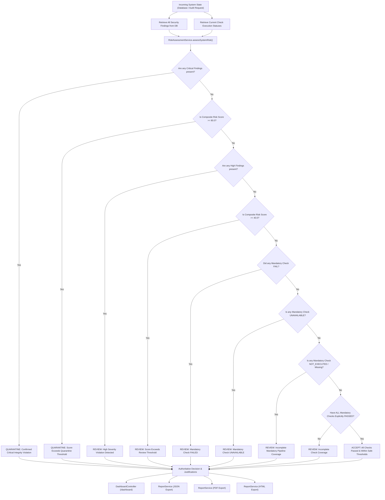

# SentinelCV — Security Decision Trace Matrix

## 1. Overview

SentinelCV employs a defense-in-depth architecture where every security and integrity check is evaluated deterministically. Decisions are never inferred from the absence of findings or aggregate counters. Instead, every mandatory pipeline emits an authoritative `CheckExecutionStatus` (`PASSED`, `FAILED`, `UNAVAILABLE`, `NOT_EXECUTED`) that is directly evaluated by the central `RiskAssessmentService`.

To prevent false `ACCEPT` states, SentinelCV strictly enforces the following decision precedence:
1. **QUARANTINE**: Any `CRITICAL` severity finding OR composite risk score $\ge 80.0$ OR confirmed cryptographic tampering / broken hash chain.
2. **REVIEW**: Any `HIGH` severity finding OR composite risk score $\ge 40.0$ OR any mandatory check `FAILED` OR any mandatory check `UNAVAILABLE` OR any mandatory check `NOT_EXECUTED` (including empty database / missing check status).
3. **ACCEPT**: Strictly requires that **every mandatory check** (`model.baseline_inference`, `model.trigger_perturbation`, `dataset.integrity`, `provenance.verification`) has explicitly **`PASSED`**, with composite risk score $< 40.0$ and zero critical or high-risk findings.

---

## 2. Mandatory Security Decision Trace Matrix

| Mandatory Check Name | Pipeline Input | Input Validation & Pre-conditions | Analyzer & Execution Engine | Execution Status Generated | Security Findings Emitted | Risk Assessment Engine Impact | Persistence Table | Dashboard & Report Representation |
| :--- | :--- | :--- | :--- | :--- | :--- | :--- | :--- | :--- |
| **`model.baseline_inference`** | Model binary path (ONNX `.onnx` or TorchScript `.pt`), tensor shapes, configuration. | Magic byte check, path confinement, model loader format dispatch, tensor dimension validation. | `BehavioralAnalyzer.testBaselineInference()` & `OnnxModelLoader` / `TorchScriptModelLoader`. | `PASSED` `FAILED` `UNAVAILABLE` | `FIND-MODEL-INFER-FAIL` `FIND-MODEL-UNSUPPORTED` `FIND-MODEL-TIMEOUT` | If `PASSED` & no findings: eligible for `ACCEPT`. If `FAILED`: mandates `REVIEW`. If `UNAVAILABLE`: mandates `REVIEW` (blocks false ACCEPT). | `ml_models` `model_audits` `model_findings` `security_findings` `audit_history` | Displayed on `/dashboard` model audit card, `/models/{id}` view, and JSON/PDF/HTML audit reports. |
| **`model.trigger_perturbation`** | Model binary, synthetic perturbation patterns (chessboard, localized spatial patch, Gaussian noise). | Baseline inference verified, input layout confirmed `[1, C, H, W]`, output dimensions verified. | `TriggerAnalyzer.analyzePerturbationSensitivity()` | `PASSED` `FAILED` `UNAVAILABLE` | `FIND-MODEL-TRIGGER-CRIT` (sensitivity $\ge 0.85$) `FIND-MODEL-TRIGGER-HIGH` `FIND-MODEL-TRIGGER-MED` | Sensitivity $\ge 0.85$ emits `CRITICAL` finding $\rightarrow$ mandates `QUARANTINE`. Sensitivity $\ge 0.50$ emits `HIGH` $\rightarrow$ mandates `REVIEW`. Inference failure $\rightarrow$ `UNAVAILABLE` $\rightarrow$ mandates `REVIEW`. | `model_audits` `model_findings` `security_findings` `audit_history` | Metric visualizations in model audit UI, high-risk flags on `/dashboard`, finding justifications in reports. |
| **`dataset.integrity`** | Archive file / extracted dataset directory, image payloads, annotation files (COCO/YOLO). | Staging directory extraction, Zip-Slip check, compression ratio check, magic byte check, destination collision check. | `ImageIntegrityAnalyzer`, `AnnotationValidator`, `DuplicateDetector`, `DatasetAuditService`. | `PASSED` `FAILED` | `FIND-DATASET-EMPTY-1` `FIND-DATASET-CORRUPT` `FIND-DATASET-DUP-HIGH` `FIND-DATASET-ANNO-OOB` | If dataset has 0 images: `FIND-DATASET-EMPTY-1` emitted, integrity score set to 0.0, status `FAILED` $\rightarrow$ mandates `REVIEW`. Corrupted images $\rightarrow$ `FAILED` $\rightarrow$ mandates `REVIEW`. All images valid & annotations clean $\rightarrow$ `PASSED`. | `datasets` `dataset_audits` `dataset_findings` `security_findings` `audit_history` | Integrity score gauge on `/dashboard`, finding table on `/datasets/{id}`, detailed breakdown in consolidated reports. |
| **`provenance.verification`** | JSON batch of `InferenceRecord` objects (`recordId`, `sequenceNumber`, `timestamp`, hashes, `nonce`, `hmacValue`). | Schema V2 canonical payload validation, 64-hex hash format validation, duplicate ID check, duplicate sequence check, sequence gap check. | `InferenceValidator.verifyRecords()` & `InferenceProvenanceService`. | `PASSED` `FAILED` `UNAVAILABLE` | `FIND-PROV-TAMPER` `FIND-PROV-REPLAY` `FIND-PROV-UNAVAIL` `FIND-PROV-BROKEN-CHAIN` | Empty batch: status `UNAVAILABLE` $\rightarrow$ decision `UNAVAILABLE`, mandates `REVIEW` in system risk. Cryptographic tampering / broken chain: status `FAILED` $\rightarrow$ decision `QUARANTINE`. Replay attack alone: status `FAILED` $\rightarrow$ decision `REVIEW`. Missing HMAC key: status `UNAVAILABLE` $\rightarrow$ decision `REVIEW`. | `inference_records` `provenance_verifications` `security_findings` `audit_history` | Provenance chain timeline on `/inference`, verification pill status, decision badges on `/dashboard` and reports. |

---

## 3. Supplemental Pipeline Trace: Dataset Drift Analysis

| Feature | Pipeline Details |
| :--- | :--- |
| **Pipeline Name** | `drift.distribution_shift` |
| **Input Assets** | Reference Dataset ID and Evaluation Dataset ID. |
| **Validation Rules** | Both datasets must exist and contain at least 5 images (`StatisticalUtil.MIN_SAMPLE_SIZE = 5`). |
| **Analyzer Engine** | `FeatureStatistics.extractDistributions()` (brightness, contrast, edge density, color histograms) & `DistributionComparator.compareWithClasses()`. |
| **Status Generated** | `COMPLETED` (statistical significance established) OR `UNAVAILABLE` (sample size $< 5$). |
| **Findings Emitted** | `FIND-DRIFT-UNAVAILABLE` (`INFO` severity, confidence 1.0) when sample size $< 5$. `FIND-DRIFT-CRITICAL` (`CRITICAL` severity) when drift score $\ge 0.50$. `FIND-DRIFT-HIGH` (`HIGH` severity) when drift score $\ge 0.25$. |
| **System Decision Impact** | Critical drift mandates `QUARANTINE`. High drift or Unavailable sample size mandates `REVIEW`. Absence of drift does not fabricate a PASSED mandatory check. |
| **Persistence & UI** | Stored in `drift_audits` and `security_findings`. Displayed on `/drift` comparisons and consolidated PDF/JSON reports. |

---

## 4. End-to-End Decision Flow Diagram

---

## 5. Verification Proof Summary

| Scenario | Check Statuses | Findings Present | Resulting Decision | Justification |
| :--- | :--- | :--- | :--- | :--- |
| **Empty Database** | None (All `NOT_EXECUTED`) | 0 findings | **`REVIEW`** | Missing check statuses are marked `NOT_EXECUTED`; false `ACCEPT` is prevented. |
| **Model Inferred, Others Unrun** | `model.baseline_inference`: `PASSED` Others: `NOT_EXECUTED` | 0 findings | **`REVIEW`** | Pipeline coverage is incomplete (3 checks unexecuted). |
| **All Checks Passed** | All 4 checks: `PASSED` | 0 findings | **`ACCEPT`** | Every mandatory check explicitly verified clean. |
| **All Checks Passed + 1 Medium** | All 4 checks: `PASSED` | 1 Medium finding | **`ACCEPT`** | Weighted risk score 6.0 is below review threshold 40.0. |
| **All Checks Passed + 1 High** | All 4 checks: `PASSED` | 1 High finding | **`REVIEW`** | High severity finding takes precedence over check pass. |
| **1 Check Unavailable** | 3 `PASSED`, 1 `UNAVAILABLE` | 0 findings | **`REVIEW`** | Incomplete evaluation cannot certify safe deployment. |
| **1 Check Unavailable + 1 Critical**| 3 `PASSED`, 1 `UNAVAILABLE` | 1 Critical finding | **`QUARANTINE`** | Critical finding takes strict precedence over unavailable status. |
| **Empty Inference Batch** | `provenance.verification`: `UNAVAILABLE` | 0 findings | **`REVIEW`** | Empty provenance batch cannot award `VERIFIED`. |
| **Tampered Provenance Record** | `provenance.verification`: `FAILED` | `FIND-PROV-TAMPER` (`CRITICAL`) | **`QUARANTINE`** | Confirmed cryptographic hash or HMAC mismatch mandates quarantine. |

